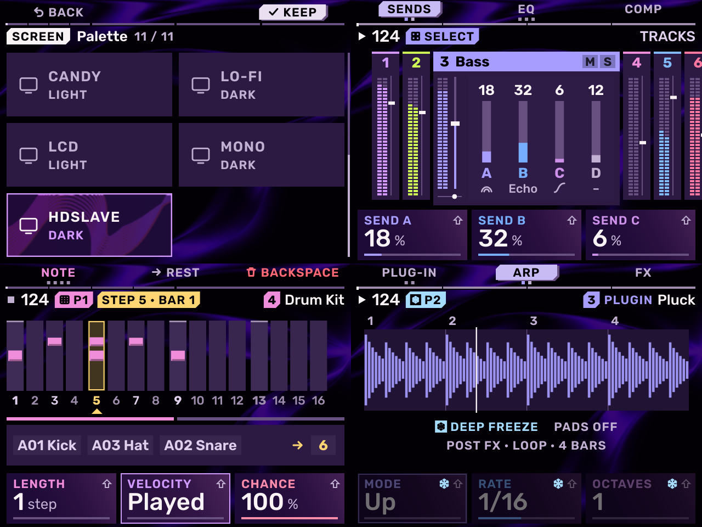
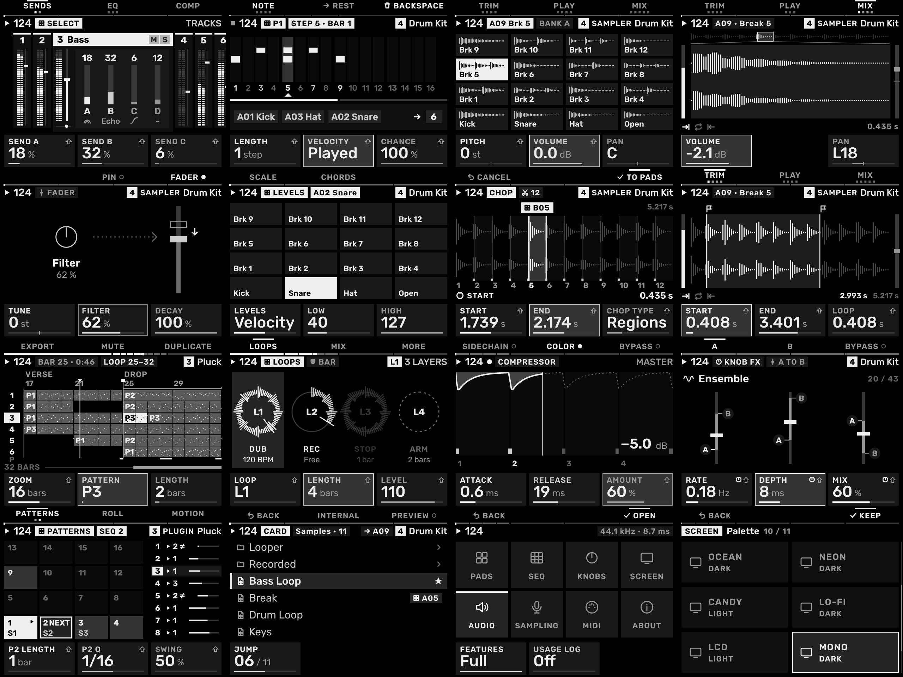
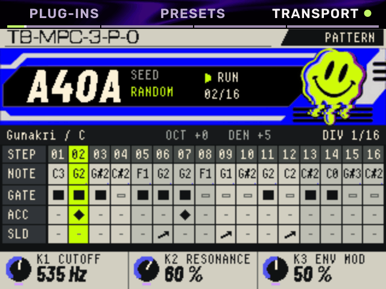
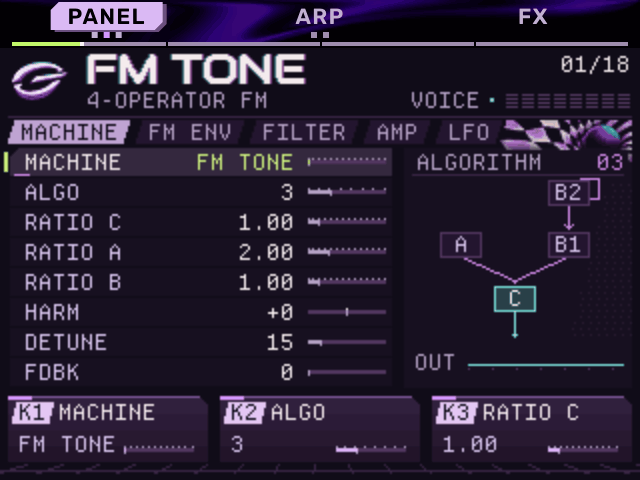
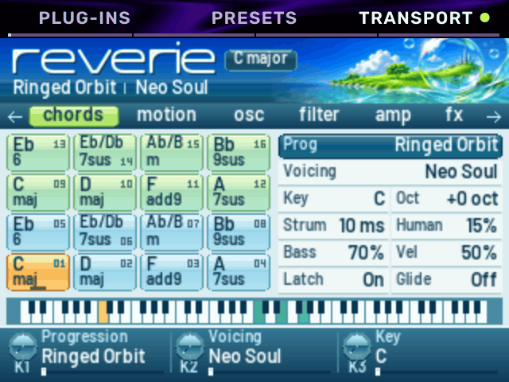
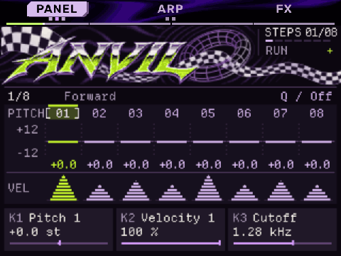
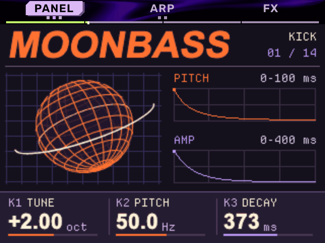
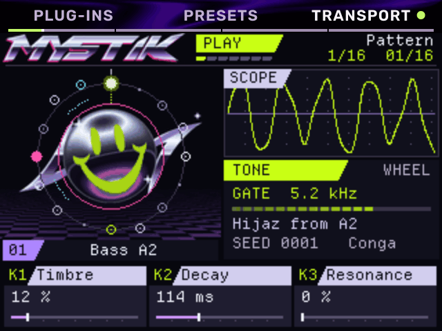

<h1 align="center">hdslave MPC Sample Synths &amp; Drum Machines</h1>

<p align="center"><strong>11 custom CLAP synthesizers, drum machines, and effects — plus <a href="https://github.com/hdslave/hdslaveOS">hdslaveOS</a> — built for the Akai MPC Sample.</strong></p>

Each instrument, effect, and OS lives in its own repository and is pinned here as a git submodule so a single clone fetches the entire suite. Every plug-in ships as a standalone 64-bit ARM Linux `.clap` binary and draws its own live, hardware-inspired interface directly on the MPC Sample's screen when running in **hdslaveOS**.

```sh
git clone --recurse-submodules https://github.com/hdslave/hdslave-MPCSample-Synths-and-Drum-Machines.git
```

<sub>Already cloned without <code>--recurse-submodules</code>? Run <code>git submodule update --init --recursive</code> inside the folder.</sub>

> **Desktop CLAP builds (macOS & Windows):** Every plug-in repository below includes both its MPC Sample version and a separate desktop CLAP build in its `mac-clap/` folder (all MPC screens on one interactive panel + MIDI Learn). Releases stay MPC Sample-only for now while the desktop builds are being finalized.

---

## hdslaveOS

[**hdslaveOS**](https://github.com/hdslave/hdslaveOS) (formerly `melodee-hdslave`) is hdslave's performance-tuned fork of [Melodee](https://github.com/keremimo/melodee-sample) by Kerem Kiliç (Ellic Studio), tracking Melodee v0.7.1. It cuts idle CPU and display overhead while staying bit-identical in audio, and powers the custom plug-in screens shown below. Download the unsigned OS package and its matching MPC plug-in bundle from the [hdslaveOS v0.7.1-hdslave.13 release](https://github.com/hdslave/hdslaveOS/releases/tag/v0.7.1-hdslave.13).

Screenshots from the hdslaveOS 0.8.1 development build.

<table>
  <tr>
    <td align="center" width="50%">
      <a href="https://github.com/hdslave/hdslaveOS"></a><br>
      <sub><b>HDSLAVE</b> — default static purple flare on black</sub>
    </td>
    <td align="center" width="50%">
      <a href="https://github.com/hdslave/hdslaveOS"></a><br>
      <sub><b>MONO</b> — high-contrast black-and-white dark mode</sub>
    </td>
  </tr>
</table>

- **Efficiency & power**: Less wasted work on the MPC Sample's Cortex-A55, plus **CPU speed**, **Refresh**, **Dim after**, and **Pad brightness** controls.
- **Custom plug-in screens**: Uses Melodee 0.7’s `melodee.screen/1` extension. The synths and drum machines have interactive Edit and Stage pages, and Cortex Filter also has an FX rack strip.
- **Playability**: Wakes sleeping plug-ins when you turn a knob, keys the master compressor's Sidechain from a plug-in's second output (Foundry's kick-only **SC Key**), steps a bar at a time with **SHIFT + encoder** on Step Edit, and lights kit pads more vividly.
- **Non-destructive**: Runs from the microSD card (`autorun/melodee` and `Melodee/`), licensed AGPL-3.0 like Melodee. See [hdslaveOS/README.md](https://github.com/hdslave/hdslaveOS) for build and install details.

### Mixer in 0.8.1

<p align="center">
  
  <br><sub>Submix sends, insert effects, channel EQ, and compression.</sub>
</p>

---

## Synthesizers

<table>
  <tr>
    <td width="340" align="center">
      <a href="https://github.com/hdslave/TB-MPC-3-P-0-Synthesizer"></a>
    </td>
    <td>
      <h3><a href="https://github.com/hdslave/TB-MPC-3-P-0-Synthesizer">TB-MPC-3-P-0</a></h3>
      <p><strong>303-style acid bass synthesizer + TB-3PO generative sequencer.</strong></p>
      <p>Pairs a classic 303 diode ladder / Twin Peak / 18 dB bass voice with a tick-accurate port of Ornament &amp; Crime's Hemisphere <b>TB-3PO</b> acid pattern generator (same seed, density, and scale produce the exact module pattern). Its <b>Press Plate</b> screen displays every step's note, gate, accent, and slide, with a <b>Blacklight Transfer</b> theme one press away.</p>
    </td>
  </tr>
  <tr>
    <td width="340" align="center">
      <a href="https://github.com/hdslave/hdslave-Psychic-Synth"></a>
    </td>
    <td>
      <h3><a href="https://github.com/hdslave/hdslave-Psychic-Synth">Psychic</a></h3>
      <p><strong>Generative analog-style dual-sequencer synth (Labyrinth panel &amp; flow).</strong></p>
      <p>Through-zero FM, ring mod, wavefolder, and a 2-pole state-variable filter driven by two corruptible 8-bit sequencers that can chain into a 16-step ring. Its <b>Contact Sheet</b> screen prints saved vs. live steps side by side, highlighting every mutated gate and voltage with direct per-cell editing.</p>
    </td>
  </tr>
  <tr>
    <td width="340" align="center">
      <a href="https://github.com/hdslave/hdslave-Machine"></a>
    </td>
    <td>
      <h3><a href="https://github.com/hdslave/hdslave-Machine">Machine</a></h3>
      <p><strong>Multi-machine synth &amp; drum engine in the style of Elektron's machines.</strong></p>
      <p>18 engines under one roof: an 8-voice 4-op <b>FM TONE</b>, seven drum machines (BD, SD, CP, HH, CY/CB, EFM DRUM, GND), an 8-slot <b>KIT</b>, eight experimental voices (<b>TERRAIN</b>, <b>PHASE</b>, <b>VOX</b>, <b>MODAL</b>, <b>PLUCK</b>, <b>GENDY</b>, <b>PULSAR</b>, <b>ORGAN</b>), and a volca-style resonator <b>KICK</b> — all sharing a filter, drive, envelopes, LFO, and bespoke raised-banner screens.</p>
    </td>
  </tr>
  <tr>
    <td width="340" align="center">
      <a href="https://github.com/hdslave/hdslave-Nexus-Synth"></a>
    </td>
    <td>
      <h3><a href="https://github.com/hdslave/hdslave-Nexus-Synth">Nexus</a></h3>
      <p><strong>8-voice polyphonic macro-oscillator synth powered by Mutable Instruments Plaits.</strong></p>
      <p>All 24 original Plaits engines running at native 48 kHz with mono/poly/legato &amp; unison, two ADSRs, two LFOs, cycling envelope, random source, filter, fixed routes, 4×4 assign matrix, and Melodee Slide &amp; Tie. Seven acid-rave pages pair model banks with a live scope, voice activity, filter curve, envelopes, LFOs, and modulation matrices.</p>
    </td>
  </tr>
  <tr>
    <td width="340" align="center">
      <a href="https://github.com/hdslave/hdslave-Reverie-Synth"></a>
    </td>
    <td>
      <h3><a href="https://github.com/hdslave/hdslave-Reverie-Synth">Reverie</a></h3>
      <p><strong>Chord-progression &amp; X/Y Motion pad synthesizer.</strong></p>
      <p>208 chord progressions taken from the factory pad chord sets of Korg's M3 workstation and Pioneer DJ's TORAIZ SQUID sequencer, played straight from the MPC pads, every chord named from its own notes, voiced and voice-led across six styles in any key — with progressions and patches selected independently. Dual morphing wavetable oscillators with unison, drift, and Korg M3-inspired <b>Motion</b> paths feed ensemble, tempo delay, and shimmer reverb across six Frutiger Aero pages.</p>
    </td>
  </tr>
  <tr>
    <td width="340" align="center">
      <a href="https://github.com/hdslave/hdslave-Necronomicon-Synth"></a>
    </td>
    <td>
      <h3><a href="https://github.com/hdslave/hdslave-Necronomicon-Synth">Necronomicon</a></h3>
      <p><strong>Polyrhythmic subharmonic synthesizer (Subharmonicon panel &amp; flow).</strong></p>
      <p>Two VCOs, each with two phase-locked subharmonic dividers (1/1 to 1/16), a 4-pole ladder filter, two 4-step sequencers, and four polyrhythmic clock generators with OR/XOR logic. Its <b>Liquid Light</b> screen renders four stained-glass rhythm wheels that track each divisor's phase and sequencer routing in real time.</p>
    </td>
  </tr>
</table>

---

## Drums &amp; Percussion

<table>
  <tr>
    <td width="340" align="center">
      <a href="https://github.com/hdslave/hdslave-Foundry-Drum-Machine"></a>
    </td>
    <td>
      <h3><a href="https://github.com/hdslave/hdslave-Foundry-Drum-Machine">Foundry</a></h3>
      <p><strong>16-voice 808 / 909 / 606 drum machine with TR-1000-style per-voice shaping.</strong></p>
      <p>Circuit-modelled 808, 909, and modded-606 models on every pad with per-voice bend, drive, filter, envelopes, probability, flams, sub-steps, and a dedicated kick-only <b>SC Key</b> sidechain output for hdslaveOS's master compressor, plus reverb, delay, and bus comp. Its <b>X0X Drum Works</b> page shows live pad triggers and a 2-second hit timeline.</p>
    </td>
  </tr>
  <tr>
    <td width="340" align="center">
      <a href="https://github.com/hdslave/hdslave-Anvil-Synth"></a>
    </td>
    <td>
      <h3><a href="https://github.com/hdslave/hdslave-Anvil-Synth">Anvil</a></h3>
      <p><strong>8-step analog-style percussion synthesizer (DFAM / Edge panel &amp; flow).</strong></p>
      <p>Dual VCOs with linear FM, hard sync, white/pink noise, overdriving mixer, and a 4-pole LP/HP ladder filter driven by a host-synced 8-step pitch &amp; velocity sequencer — plus a new <b>VCO EG &gt; FM 1-2 Amt</b> modulation control and a live step-bar screen on the MPC.</p>
    </td>
  </tr>
  <tr>
    <td width="340" align="center">
      <a href="https://github.com/hdslave/hdslave-MoonBass-Synth"></a>
    </td>
    <td>
      <h3><a href="https://github.com/hdslave/hdslave-MoonBass-Synth">MoonBass</a></h3>
      <p><strong>Analog-style kick drum synthesizer (ModBase 09 Mk I/II &amp; MBase 11 style).</strong></p>
      <p>Every panel knob and hidden menu parameter — harmonics, pulse, dual metal noise, gate compression, dual LFOs, and 4 CV slots — laid out across 14 pages. Its <b>Orbital Impact</b> screen draws a reactive wireframe moon alongside live pitch-sweep and amplitude-decay curves.</p>
    </td>
  </tr>
  <tr>
    <td width="340" align="center">
      <a href="https://github.com/hdslave/hdslave-Mystik-Synth"></a>
    </td>
    <td>
      <h3><a href="https://github.com/hdslave/hdslave-Mystik-Synth">Mystik</a></h3>
      <p><strong>West-coast hand drum &amp; Buchla-style vactrol low-pass gate synthesizer.</strong></p>
      <p>An 8-mode physical membrane (nine bodies from tabla to iron bell) and complex wavefolding oscillator struck with eight hand strokes through a modelled 292 vactrol LPG, sequenced by six modes (Pattern, Euclid, Turing, Automaton, Bounce, and 14 traditional Rhythm timelines) with 303-style accents/slides and four lo-fi effects across seven acid-rave pages.</p>
    </td>
  </tr>
</table>

---

## Effects

<table>
  <tr>
    <td width="340" align="center">
      <a href="https://github.com/hdslave/hdslave-Cortex-Filter"></a>
    </td>
    <td>
      <h3><a href="https://github.com/hdslave/hdslave-Cortex-Filter">Cortex Filter</a></h3>
      <p><strong>Stereo 3D Z-plane morphing filter cube &amp; filter sequencer.</strong></p>
      <p>Inspired by E-mu Z-plane and Rossum Morpheus filter cubes: morph smoothly across eight corner filters in 3D space (Morph, Freq, Transform) with a 64-filter bank, per-side distortion, LFO, envelope follower, and a clock/envelope-triggered filter sequencer. Renders a live 3D rotating cube and 3D frequency-response waterfall right on the MPC's screen.</p>
    </td>
  </tr>
</table>

Each plug-in repository's README documents its full signal flow, parameter tables, factory presets, tests, and CPU cost.

---

## Install on the MPC Sample

Each plug-in builds to a single `.clap` file. Copy them onto your microSD card inside one `hdslave` subfolder so Melodee's picker groups them neatly:

```text
Melodee/Plugins/hdslave/hdslave Anvil.clap
Melodee/Plugins/hdslave/hdslave Cortex Filter.clap
Melodee/Plugins/hdslave/hdslave Foundry.clap
...
```

Load any instrument on an empty track via **Stage → Plugin → hdslave → hdslave NAME** (or insert **hdslave Cortex Filter** in any track, bus, or master FX chain). They run in any Melodee build; under **hdslaveOS**, opening **Edit** or **Stage** shows each plug-in's custom animated screen, and turning a knob wakes a sleeping plug-in.

## Build from source

Every plug-in and `hdslaveOS` builds and runs its test suite via its own `./build.sh`, using Docker with a Linux `arm64` context (Melodee's `colima-melodee` and `melodee-builder` image by default):

```sh
cd Anvil && ./build.sh
```

## Keeping it current

Submodule folders stay at their pinned commits until updated. Run `tools/update.sh` to advance every folder to the latest commit on its tracked branch (`main` for plug-ins, `hdslave` for `hdslaveOS`) and commit the updated pins; then `git push` to publish.

## Trademarks

Product names mentioned here are trademarks of their respective owners (Roland, Moog Music, Behringer, Jomox, Elektron, Korg, Pioneer DJ / AlphaTheta, E-mu, Rossum Electro-Music, Mutable Instruments, inMusic Brands). These projects are not affiliated with or endorsed by any of them, nor are they official Melodee releases.
