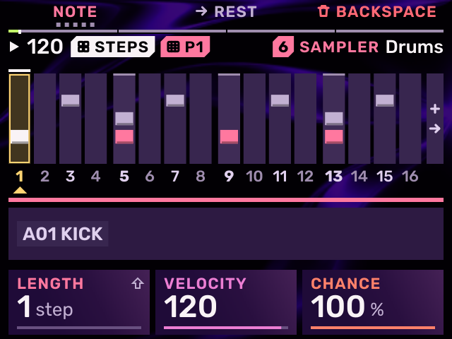
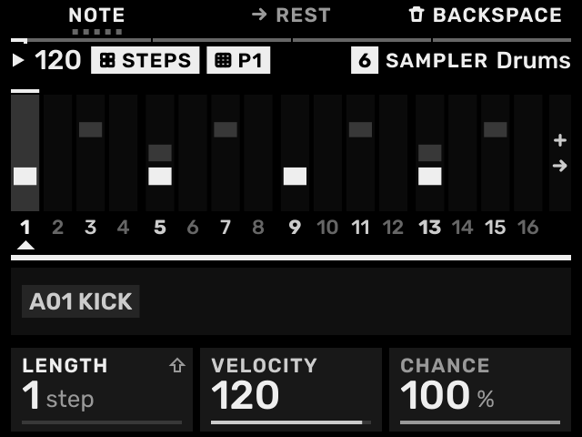
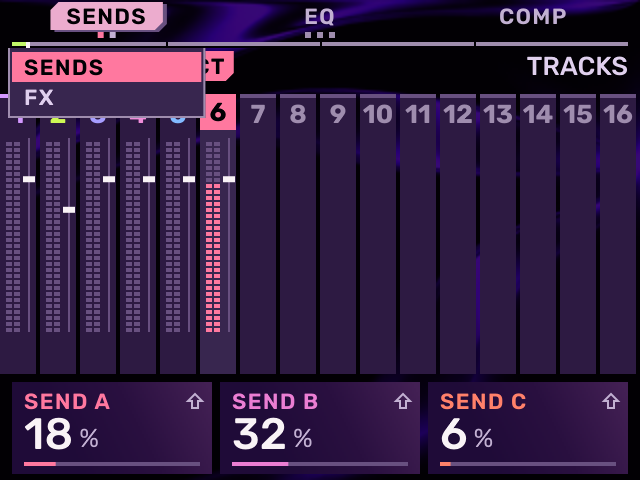

# hdslave Synths & Drum Machines

Ten instruments and one stereo effect for MPC Sample, macOS and Windows. Slink, Reverie, Anvil and Cortex Filter also have editions for the TORAIZ SP-16 running freesp16.

[Synthesizers](#synthesizers) · [Drums & percussion](#drums--percussion) · [Effects](#effects) · [Installation & source](#installation--source)

| Platform | Downloads and builds |
| --- | --- |
| **MPC Sample** | [All eleven plug-ins](https://github.com/hdslave/hdslave-Synths-and-Drum-Machines/releases/latest) or [hdslaveOS with the plug-ins included](https://github.com/hdslave/hdslaveOS/releases/latest) |
| **SP-16** | [Slink 0.9.11](https://github.com/hdslave/hdslave-Slink-Synth/releases/tag/v0.9.11) · [Reverie 0.4.4-sp16.18](https://github.com/hdslave/hdslave-Reverie-Synth/releases/tag/v0.6.6) · [Anvil 0.7.1](https://github.com/hdslave/hdslave-Anvil-Synth/releases/tag/v0.7.1) · [Cortex Filter 0.3.5](https://github.com/hdslave/hdslave-Cortex-Filter/releases/tag/v0.3.5) |
| **macOS & Windows** | [Build all eleven desktop plug-ins](https://github.com/hdslave/hdslave-Synths-and-drum-machines-Mac-Win/blob/main/docs/building.md). Download [Slink in CLAP format](https://github.com/hdslave/hdslave-Slink-Synth/releases/tag/v0.9.11) or [Reverie in CLAP and VST3](https://github.com/hdslave/hdslave-Reverie-Synth/releases/tag/desktop-v0.3.7). |

Select an interface to open its full-size recording.

## Synthesizers

### [Slink](https://github.com/hdslave/hdslave-Slink-Synth)

Slink makes acid bass lines with the TB-3PO pattern generator. Dial in a seed, density and scale to recall a line, then edit its notes, gates, accents and slides. On the SP-16, drag the pitch trace to change a note or tap a step number to hear it.

<p>
  <strong>SP-16</strong> · <a href="https://github.com/hdslave/hdslave-Slink-Synth/blob/main/docs/screen.md#thorn-crown-on-freesp16">Thorn Crown pattern editor</a><br>
  <a href="https://github.com/hdslave/hdslave-Slink-Synth/blob/main/docs/slink-sp16.webp"></a>
</p>

<table align="left">
  <tr><th scope="col" width="319">MPC Sample</th></tr>
  <tr><td align="center" width="319"><a href="https://github.com/hdslave/hdslave-Slink-Synth/blob/main/docs/slink-screen.webp"></a></td></tr>
</table>
<table align="left">
  <tr><th scope="col" width="459">macOS &amp; Windows</th></tr>
  <tr><td align="center" width="459"><a href="https://github.com/hdslave/hdslave-Slink-Synth/blob/main/docs/slink-desktop-0.9.11.webp"></a></td></tr>
</table>
<br clear="all">

### [Reverie](https://github.com/hdslave/hdslave-Reverie-Synth)

Each pad plays a voiced chord. Pick one of 46 progressions or 18 Mood sets, then trace an X/Y Motion path to move the wavetable sound as the chord rings. The SP-16 chord page shows which notes the held pad is playing.

<p>
  <strong>SP-16</strong> · <a href="https://github.com/hdslave/hdslave-Reverie-Synth/tree/sp16-screen#sp-16">Dawn Mood chord page</a><br>
  <a href="https://github.com/hdslave/hdslave-Reverie-Synth/blob/main/docs/reverie-sp16.webp"></a>
</p>

<table align="left">
  <tr><th scope="col" width="319">MPC Sample</th></tr>
  <tr><td align="center" width="319"><a href="https://github.com/hdslave/hdslave-Reverie-Synth/blob/main/docs/reverie-pages.webp"><picture><source media="(max-resolution: 1dppx)" srcset="https://raw.githubusercontent.com/hdslave/hdslave-Reverie-Synth/main/docs/mpc-card.webp"></picture></a></td></tr>
</table>
<table align="left">
  <tr><th scope="col" width="459">macOS &amp; Windows</th></tr>
  <tr><td align="center" width="459"><a href="https://github.com/hdslave/hdslave-Reverie-Synth/blob/main/mac-clap/assets/desktop-preview.webp"><picture><source media="(max-resolution: 1dppx)" srcset="https://raw.githubusercontent.com/hdslave/hdslave-Reverie-Synth/main/mac-clap/assets/desktop-card.webp"></picture></a></td></tr>
</table>
<br clear="all">

### [Psychic](https://github.com/hdslave/hdslave-Psychic-Synth)

Two eight-step sequencers drive a voice with through-zero FM, ring modulation and a wavefolder. Introduce new gates and pitches with the corruption controls. The Contact Sheet lets you compare the live pattern with the one you saved.

<table align="left">
  <tr><th scope="col" width="319">MPC Sample</th></tr>
  <tr><td align="center" width="319"><a href="https://github.com/hdslave/hdslave-Psychic-Synth/blob/main/docs/psychic-screen.webp"><picture><source media="(max-resolution: 1dppx)" srcset="https://raw.githubusercontent.com/hdslave/hdslave-Psychic-Synth/main/docs/mpc-card.webp"></picture></a></td></tr>
</table>
<table align="left">
  <tr><th scope="col" width="459">macOS &amp; Windows</th></tr>
  <tr><td align="center" width="459"><a href="https://github.com/hdslave/hdslave-Psychic-Synth/blob/main/mac-clap/assets/desktop-preview.webp"></a></td></tr>
</table>
<br clear="all">

### [Machine](https://github.com/hdslave/hdslave-Machine)

Switch among 18 engines, from four-operator FM and an eight-slot drum kit to plucked strings and a resonator kick. The engines share a filter, drive and envelopes, so you can shape a new voice with familiar controls.

<table align="left">
  <tr><th scope="col" width="319">MPC Sample</th></tr>
  <tr><td align="center" width="319"><a href="https://github.com/hdslave/hdslave-Machine/blob/main/docs/machine-screen.webp"><picture><source media="(max-resolution: 1dppx)" srcset="https://raw.githubusercontent.com/hdslave/hdslave-Machine/main/docs/mpc-card.webp"></picture></a></td></tr>
</table>
<table align="left">
  <tr><th scope="col" width="459">macOS &amp; Windows</th></tr>
  <tr><td align="center" width="459"><a href="https://github.com/hdslave/hdslave-Machine/blob/main/mac-clap/assets/desktop-preview.webp"></a></td></tr>
</table>
<br clear="all">

### [Nexus](https://github.com/hdslave/hdslave-Nexus-Synth)

Play all 24 Plaits oscillator models across eight voices. Route velocity to timbre for accents, stack voices in unison, or use two envelopes and two LFOs to animate a held chord.

<table align="left">
  <tr><th scope="col" width="319">MPC Sample</th></tr>
  <tr><td align="center" width="319"><a href="https://github.com/hdslave/hdslave-Nexus-Synth/blob/main/docs/nexus-pages.webp"><picture><source media="(max-resolution: 1dppx)" srcset="https://raw.githubusercontent.com/hdslave/hdslave-Nexus-Synth/main/docs/mpc-card.webp"></picture></a></td></tr>
</table>
<table align="left">
  <tr><th scope="col" width="459">macOS &amp; Windows</th></tr>
  <tr><td align="center" width="459"><a href="https://github.com/hdslave/hdslave-Nexus-Synth/blob/main/mac-clap/assets/desktop-preview.webp"><picture><source media="(max-resolution: 1dppx)" srcset="https://raw.githubusercontent.com/hdslave/hdslave-Nexus-Synth/main/mac-clap/assets/desktop-card.webp"></picture></a></td></tr>
</table>
<br clear="all">

### [Necronomicon](https://github.com/hdslave/hdslave-Necronomicon-Synth)

Tune two oscillators and four subharmonics into a chord. Four clock dividers drive a pair of four-step sequencers at different rates. The rhythm wheels show when their pulses line up.

<table align="left">
  <tr><th scope="col" width="319">MPC Sample</th></tr>
  <tr><td align="center" width="319"><a href="https://github.com/hdslave/hdslave-Necronomicon-Synth/blob/main/docs/necronomicon-screen.webp"><picture><source media="(max-resolution: 1dppx)" srcset="https://raw.githubusercontent.com/hdslave/hdslave-Necronomicon-Synth/main/docs/mpc-card.webp"></picture></a></td></tr>
</table>
<table align="left">
  <tr><th scope="col" width="459">macOS &amp; Windows</th></tr>
  <tr><td align="center" width="459"><a href="https://github.com/hdslave/hdslave-Necronomicon-Synth/blob/main/mac-clap/assets/desktop-preview.webp"><picture><source media="(max-resolution: 1dppx)" srcset="https://raw.githubusercontent.com/hdslave/hdslave-Necronomicon-Synth/main/mac-clap/assets/desktop-card.webp"></picture></a></td></tr>
</table>
<br clear="all">

## Drums & percussion

### [Anvil](https://github.com/hdslave/hdslave-Anvil-Synth)

Program eight steps of pitch and velocity for two oscillators and noise. Hard sync and linear FM take the same sequence from tuned toms to metallic hits. On the SP-16, select a step to edit its pitch and velocity with the first two encoders.

<p>
  <strong>SP-16</strong> · <a href="https://github.com/hdslave/hdslave-Anvil-Synth/blob/main/README.md#freesp16">Pitch and velocity sequencer</a><br>
  <a href="https://github.com/hdslave/hdslave-Anvil-Synth/blob/main/docs/sp16/steps.webp"></a>
</p>

<table align="left">
  <tr><th scope="col" width="319">MPC Sample</th></tr>
  <tr><td align="center" width="319"><a href="https://github.com/hdslave/hdslave-Anvil-Synth/blob/main/docs/anvil-screen.webp"><picture><source media="(max-resolution: 1dppx)" srcset="https://raw.githubusercontent.com/hdslave/hdslave-Anvil-Synth/main/docs/mpc-card.webp"></picture></a></td></tr>
</table>
<table align="left">
  <tr><th scope="col" width="459">macOS &amp; Windows</th></tr>
  <tr><td align="center" width="459"><a href="https://github.com/hdslave/hdslave-Anvil-Synth/blob/main/mac-clap/assets/desktop-preview.webp"></a></td></tr>
</table>
<br clear="all">

### [Foundry](https://github.com/hdslave/hdslave-Foundry-Drum-Machine)

Each of the 16 pads has its own drum voice, with a choice of 808, 909 or 606 models. Shape each hit with bend, drive and envelopes. A separate kick output can key the hdslaveOS master compressor.

<table align="left">
  <tr><th scope="col" width="319">MPC Sample</th></tr>
  <tr><td align="center" width="319"><a href="https://github.com/hdslave/hdslave-Foundry-Drum-Machine/blob/main/docs/foundry-screen.webp"><picture><source media="(max-resolution: 1dppx)" srcset="https://raw.githubusercontent.com/hdslave/hdslave-Foundry-Drum-Machine/main/docs/mpc-card.webp"></picture></a></td></tr>
</table>
<table align="left">
  <tr><th scope="col" width="459">macOS &amp; Windows</th></tr>
  <tr><td align="center" width="459"><a href="https://github.com/hdslave/hdslave-Foundry-Drum-Machine/blob/main/mac-clap/assets/desktop-preview.webp"><picture><source media="(max-resolution: 1dppx)" srcset="https://raw.githubusercontent.com/hdslave/hdslave-Foundry-Drum-Machine/main/mac-clap/assets/desktop-card.webp"></picture></a></td></tr>
</table>
<br clear="all">

### [MoonBass](https://github.com/hdslave/hdslave-MoonBass-Synth)

Build a kick from its pitch sweep, harmonics, noise and decay. The Orbital Impact panel plots the pitch and amplitude curves as you play, so you can see where the attack ends and the low tail takes over.

<table align="left">
  <tr><th scope="col" width="319">MPC Sample</th></tr>
  <tr><td align="center" width="319"><a href="https://github.com/hdslave/hdslave-MoonBass-Synth/blob/main/docs/moonbass-screen.webp"><picture><source media="(max-resolution: 1dppx)" srcset="https://raw.githubusercontent.com/hdslave/hdslave-MoonBass-Synth/main/docs/mpc-card.webp"></picture></a></td></tr>
</table>
<table align="left">
  <tr><th scope="col" width="459">macOS &amp; Windows</th></tr>
  <tr><td align="center" width="459"><a href="https://github.com/hdslave/hdslave-MoonBass-Synth/blob/main/mac-clap/assets/desktop-preview.webp"><picture><source media="(max-resolution: 1dppx)" srcset="https://raw.githubusercontent.com/hdslave/hdslave-MoonBass-Synth/main/mac-clap/assets/desktop-card.webp"></picture></a></td></tr>
</table>
<br clear="all">

### [Mystik](https://github.com/hdslave/hdslave-Mystik-Synth)

Play eight hand strokes on nine modeled drum bodies, from tabla to iron bell. A wavefolding oscillator and low-pass gate shape the strike. Sequence the strokes with Euclidean rhythms, a Turing generator or one of the built-in rhythm patterns.

<table align="left">
  <tr><th scope="col" width="319">MPC Sample</th></tr>
  <tr><td align="center" width="319"><a href="https://github.com/hdslave/hdslave-Mystik-Synth/blob/main/docs/mystik-pages.webp"><picture><source media="(max-resolution: 1dppx)" srcset="https://raw.githubusercontent.com/hdslave/hdslave-Mystik-Synth/main/docs/mpc-card.webp"></picture></a></td></tr>
</table>
<table align="left">
  <tr><th scope="col" width="459">macOS &amp; Windows</th></tr>
  <tr><td align="center" width="459"><a href="https://github.com/hdslave/hdslave-Mystik-Synth/blob/main/mac-clap/assets/desktop-preview.webp"><picture><source media="(max-resolution: 1dppx)" srcset="https://raw.githubusercontent.com/hdslave/hdslave-Mystik-Synth/main/mac-clap/assets/desktop-card.webp"><source media="(max-resolution: 2dppx)" srcset="https://raw.githubusercontent.com/hdslave/hdslave-Mystik-Synth/main/mac-clap/assets/desktop-card-2x.webp"></picture></a></td></tr>
</table>
<br clear="all">

## Effects

### [Cortex Filter](https://github.com/hdslave/hdslave-Cortex-Filter)

Move through the eight corners of a stereo filter cube on three axes. Sequence changes across a bank of 64 filters, then watch the frequency response move in the waterfall display.

<p>
  <strong>SP-16</strong> · <a href="https://github.com/hdslave/hdslave-Cortex-Filter#sp-16-effect-editor">Cube effect editor</a><br>
  <a href="https://github.com/hdslave/hdslave-Cortex-Filter/blob/main/docs/cortex-sp16.webp"></a>
</p>

<table align="left">
  <tr><th scope="col" width="319">MPC Sample</th></tr>
  <tr><td align="center" width="319"><a href="https://github.com/hdslave/hdslave-Cortex-Filter/blob/main/docs/cortex-filter-screen.webp"><picture><source media="(max-resolution: 1dppx)" srcset="https://raw.githubusercontent.com/hdslave/hdslave-Cortex-Filter/main/docs/mpc-card.webp"></picture></a></td></tr>
</table>
<table align="left">
  <tr><th scope="col" width="459">macOS &amp; Windows</th></tr>
  <tr><td align="center" width="459"><a href="https://github.com/hdslave/hdslave-Cortex-Filter/blob/main/mac-clap/assets/desktop-preview.webp"><picture><source media="(max-resolution: 1dppx)" srcset="https://raw.githubusercontent.com/hdslave/hdslave-Cortex-Filter/main/mac-clap/assets/desktop-card.webp"></picture></a></td></tr>
</table>
<br clear="all">

## Installation & source

**MPC Sample.** Extract the [plug-in pack](https://github.com/hdslave/hdslave-Synths-and-Drum-Machines/releases/latest) and copy its plug-ins into `Melodee/Plugins/hdslave/` on the microSD card. The [0.9.1-hdslave.3 pack](https://github.com/hdslave/hdslave-Synths-and-Drum-Machines/releases/tag/v0.9.1-hdslave.3) includes Slink 0.9.0, Anvil 0.7.0 and Reverie 0.6.4. For the newer individual MPC builds, see [Anvil 0.7.1](https://github.com/hdslave/hdslave-Anvil-Synth/releases/tag/v0.7.1) and [Reverie 0.6.6](https://github.com/hdslave/hdslave-Reverie-Synth/releases/tag/v0.6.6).

On an instrument track in hdslaveOS, press **B1** on Stage to switch from **PRESETS** to **PANEL**. Load Cortex Filter in an FX slot. Keep Slink’s device filename, `hdslave TB-MPC-3-P-0.clap`, so existing projects can find it.

**SP-16.** Use a plug-in-capable freesp16 build. Extract the SP-16 package for [Slink](https://github.com/hdslave/hdslave-Slink-Synth#freesp16-on-sp-16), [Reverie](https://github.com/hdslave/hdslave-Reverie-Synth/tree/sp16-screen#sp-16) or [Anvil](https://github.com/hdslave/hdslave-Anvil-Synth#freesp16) to the USB stick so its `.clap` file lands in `freesp16-data/freesp16/Plugins/`. Choose **Track Type → Plugin → Select Plugin**, select the instrument, then choose **Open UI**. For [Cortex Filter](https://github.com/hdslave/hdslave-Cortex-Filter#sp-16-effect-editor), select **Plugin** in an FX1, FX2, Send or Master slot instead.

**macOS & Windows.** The [desktop build guide](https://github.com/hdslave/hdslave-Synths-and-drum-machines-Mac-Win/blob/main/docs/building.md) covers building and installing the CLAP suite. The Slink and Reverie downloads above include builds for Apple Silicon, Intel Mac and Windows x64.

**Source.** This hub pins the eleven plug-in repositories and the MPC’s hdslaveOS as Git submodules. Clone them together with the command below. For an existing clone, run `git submodule update --init --recursive`.

```sh
git clone --recurse-submodules https://github.com/hdslave/hdslave-Synths-and-Drum-Machines.git
```

<details>
<summary><strong>hdslaveOS on the MPC Sample</strong></summary>

hdslaveOS is a techno OS for the MPC Sample. It runs from the microSD card and builds on Melodee by Kerem Kiliç (Ellic Studio). Its Stage hosts the instrument panels, and the mixer can use Foundry’s kick to drive master compression. Hold **+** in the mixer to open the selected channel and **−** to return to the strips. [hdslaveOS guide](https://github.com/hdslave/hdslaveOS) · [Melodee](https://github.com/keremimo/melodee-sample)

The same drum pattern plays in HDSLAVE and MONO. The mixer opens the drum channel to show its sends, insert effect, EQ and compression.

<p> </p>


</details>

Product and platform names are trademarks of their respective owners. These are independent projects with no affiliation to the hardware manufacturers or endorsement from the Melodee project.

## hdslave plug-in license

You may use these plug-ins to make, perform, record and sell music, including paid client work, without royalties or credit to hdslave. You may share complete, unchanged official releases for free with their notices intact. Selling the software, including it in a paid product or subscription, or distributing a modified version requires prior written permission from hdslave. Third-party components keep their own licenses. [Full plug-in license](LICENSE-hdslave-plugins.txt).
